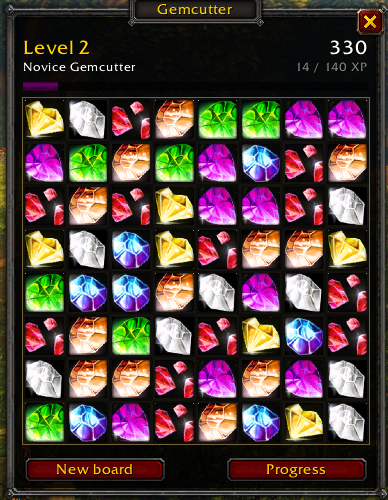

# Gemcutter

A relaxed match-3 game for World of Warcraft: Forever. You open it from the minimap button, swap
gems until you feel like stopping and close it again. It was made for long flight paths, but it
works anywhere outside combat.



The board never ends and is saved between sessions, so you pick up where you left off. Everything
you clear earns XP toward an account-wide level.

## Playing

- Open and close the board with the minimap button, the addon menu next to the minimap, or
  `/gemcutter` (short: `/gc`). Right-click the minimap button to see your progress and
  achievements.
- Drag a gem onto a neighbour, or click two neighbouring gems, to swap them.
- Three or more of the same colour in a row or column are cleared. New gems fall in, and every
  cascade raises the multiplier.
- If you stop for eight seconds, two gems that make a match start to pulse and lean toward each
  other. Swap them.
- Escape closes the window. It also closes when you enter combat or get a ready check.

Special gems:

- Four in a row makes a line gem. When it clears, it takes the whole row or column with it.
- An L, T or cross shape makes a volatile gem that clears the 3x3 square around it.
- Five in a row makes a prism. Swap it with any gem to clear every gem of that colour. Two prisms
  clear the board.

When no moves are left, the board reshuffles. The New board button starts over and only resets the
board score.

## Progression

Progress belongs to your account, not to one character. Every move earns XP based on its score.
There are 60 levels with a new rank title every ten, from Novice Gemcutter to Grand Master
Gemcutter, plus 18 achievements with XP rewards. The Progress panel shows your stats: best move,
longest chain, gems cleared and how many flights you have played on. In a simulated casual pace of
ten moves a minute, level 10 took about half an hour and level 60 about 17 hours.

## Commands

| Command | What it does |
|---|---|
| `/gemcutter` | open or close the board |
| `/gemcutter minimap` | hide or show the minimap button |
| `/gemcutter scale 0.5-2` | change the window size |
| `/gemcutter sound` | turn sound on or off |
| `/gemcutter reset` | erase all progress (asks first) |

## Installing

Install it with CurseForge or WowUp, or download the zip from the GitHub releases and unpack it into
`World of Warcraft/_forever_/Interface/AddOns/`.

## Development

The game rules (`Core.lua`) and progression (`Progression.lua`) are plain Lua 5.1 with no WoW API,
so they run outside the game. `tests/ui_smoke.lua` loads the whole addon against a strict mock of
the WoW API and plays 400 moves with mouse input and animations.

```sh
scripts/fetch-libs.sh     # LibStub, CallbackHandler, LibDataBroker and LibDBIcon into Gemcutter/Libs
scripts/check.sh          # tests, Lua 5.1 parse check, no goto
```

For local play, symlink `Gemcutter/` into the Forever `Interface/AddOns` folder after fetching the
libraries.

Releases are built by the BigWigs packager on GitHub Actions when a `v*` tag is pushed. That is the
only workflow; run `scripts/check.sh` locally and add a section for the version to `CHANGELOG.md`
first.

The gems on the board are the game's own item icons and the sounds are the game's own. The addon
icon is original art (`assets/icon.svg`). Licensed under MIT.
