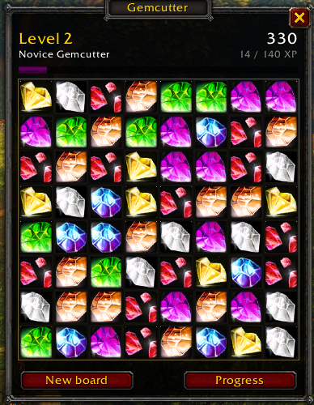
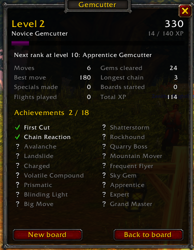

A relaxed match-3 board behind your minimap button. Open it on a long flight path, swap gems until you land, close it again.

- Left-click the minimap button or type `/gemcutter` to open the board. Right-click for your progress.
- Drag a gem onto a neighbour, or click two, to swap them. Three or more in a line are cleared, and cascades raise the multiplier.
- Four in a row makes a line gem. An L or T shape makes a volatile gem. Five in a row makes a prism that clears a whole colour.
- The board never ends and is saved between sessions.
- Everything you clear earns XP toward an account-wide level from 1 to 60, with rank titles and 18 achievements.
- The window closes on its own when combat starts.

Commands: `/gemcutter minimap` hides the button, `/gemcutter scale 0.5-2` resizes the window, `/gemcutter sound` toggles sound.

Made for World of Warcraft: Forever. Source and bug reports: [github.com/Medpus/gemcutter](https://github.com/Medpus/gemcutter)
